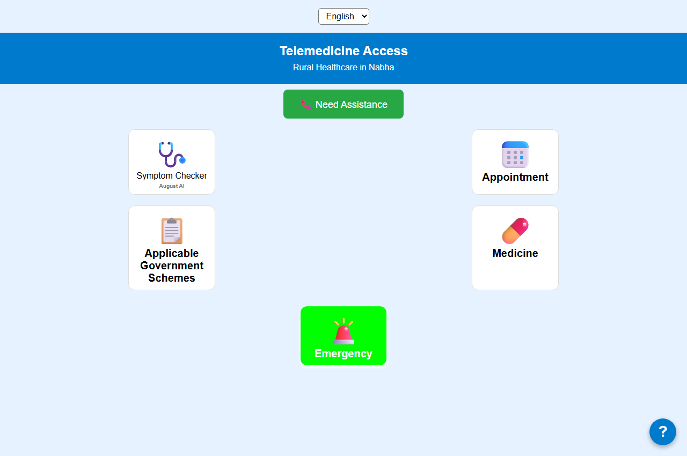
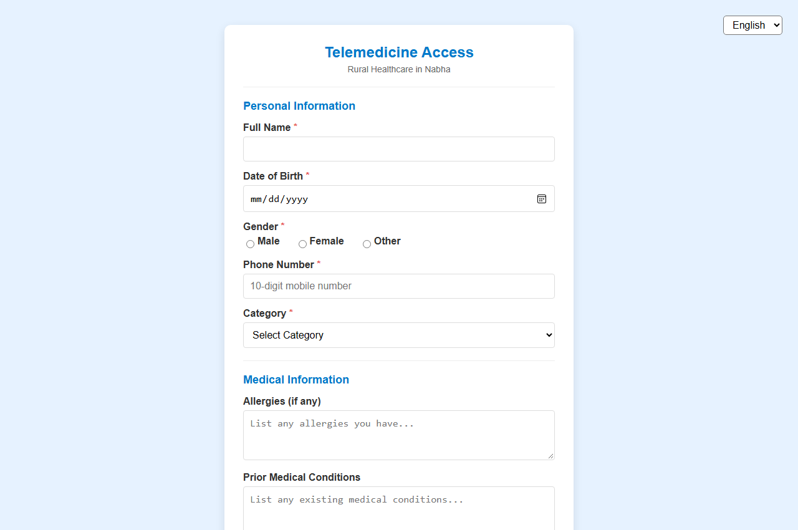

# Telemed — Rural Healthcare & Telemedicine Kiosk Portal

> Developed for the **Smart India Hackathon (SIH)** Healthcare Challenge.

A lightweight, high-availability telemedicine and digital pharmacy platform engineered for rural clinics, public community health centers, and rural telemedicine kiosks. Designed to bridge the healthcare gap in underserved regions by enabling rapid digital appointment scheduling, multi-lingual patient routing, and a real-time essential medicine inventory system.



| Patient Login & Authentication | Consultation Interface |
|---|---|
|  | Dynamic Doctor Consultation, Symptoms & Medicine Catalog |

---

## Key Features

- **Rapid Telemedicine Scheduling:** Patients or community health workers can book doctor appointments with scheduled slots, preferred doctors, and clinical symptom notes.
- **Multilingual Support:** Interface built for regional accessibility (English, Hindi, Punjabi) to serve diverse patient demographics.
- **Essential Medicines Catalog:** Integrated database (`medicines.csv`) tracking essential drug formulations, recommended dosages, subsidized pricing (INR), and inventory availability.
- **Lightweight Architecture:** Powered by Express.js and an embedded SQLite database (`appointments.db`) with zero external database server dependency, ensuring rapid setup in low-bandwidth rural environments.
- **Emergency Tele-Consultation:** Quick-dial hooks for local primary healthcare centers, civil hospitals, and tele-triage specialists.
- **Responsive Kiosk Design:** Works smoothly on touch kiosks, community laptops, tablets, and mobile browsers.

---

## Architecture Overview

```
Browser / Kiosk Client (HTML5, CSS3, ES6)
   ├── Patient & Doctor Authentication (login.html)
   └── Consultation & Pharmacy Dashboard (Telemed.html)
                   │
                   ▼ (HTTP / JSON REST API)
Express.js Application Server (server.js)
   ├── REST Routing & Appointment Management (/api/appointments)
   ├── Local Medicine Catalog Parsing (medicines.csv)
   └── Embedded SQLite Database (appointments.db)
```

---

## API Reference

| Method | Endpoint | Description |
|---|---|---|
| `GET` | `/` | Serves the main Telemed consultation interface |
| `GET` | `/api/appointments` | Retrieves all scheduled appointments ordered by date and time |
| `GET` | `/api/appointments/:id` | Retrieves appointment record by ID |
| `POST` | `/api/appointments` | Creates a new appointment (validates name, phone, date, time, doctor, symptoms) |
| `PATCH` | `/api/appointments/:id` | Updates appointment status (`pending`, `completed`, `cancelled`) |
| `DELETE` | `/api/appointments/:id` | Deletes an appointment record |

---

## Quick Start Guide

### Prerequisites
- [Node.js](https://nodejs.org/) (v16 or higher)
- npm (bundled with Node.js)

### Installation & Launch

1. Clone or download the repository:
   ```bash
   git clone https://github.com/nishantparwani/sih-telemed-portal.git
   cd sih-telemed-portal
   ```

2. Install dependencies:
   ```bash
   npm install
   ```

3. Launch the server:
   ```bash
   npm start
   ```
   *(For active development with auto-reload, run `npm run dev`)*

4. Open in your browser:
   ```
   http://localhost:3000
   ```

---

## Database & Data Structure

- **Appointments Table (`appointments.db`):**
  - `id`: INTEGER PRIMARY KEY AUTOINCREMENT
  - `name`: TEXT NOT NULL
  - `phone`: TEXT NOT NULL
  - `date`: TEXT NOT NULL (YYYY-MM-DD)
  - `time`: TEXT NOT NULL (HH:MM)
  - `doctor`: TEXT NOT NULL
  - `symptoms`: TEXT
  - `language`: TEXT
  - `status`: TEXT DEFAULT 'pending'
  - `created_at`: TIMESTAMP DEFAULT CURRENT_TIMESTAMP

- **Medicine Catalog (`medicines.csv`):**
  - Includes columns: `id`, `name`, `description`, `dosage`, `price`, `availability`.

---

## License

MIT License. Open for educational and non-commercial public health initiatives.
